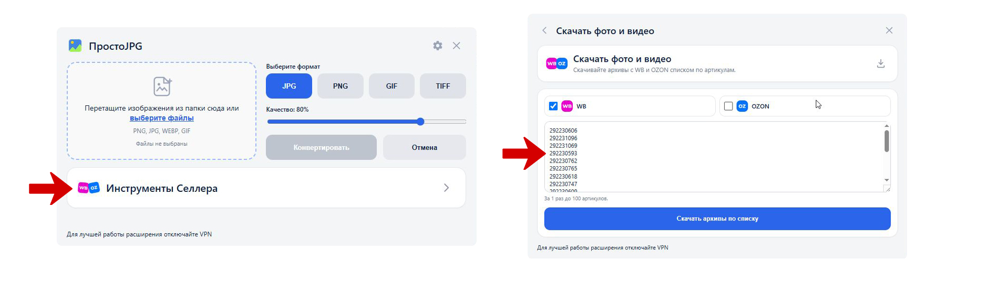
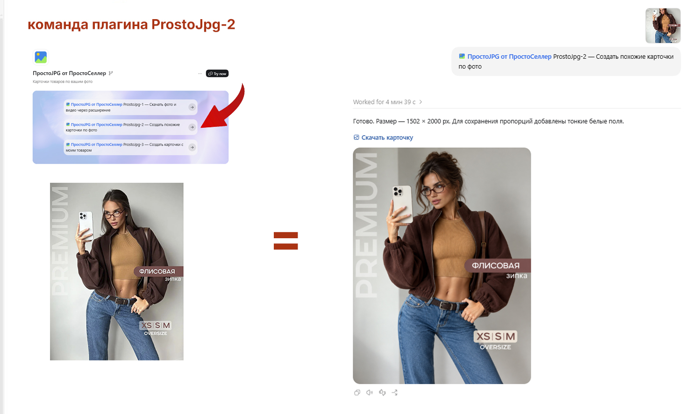
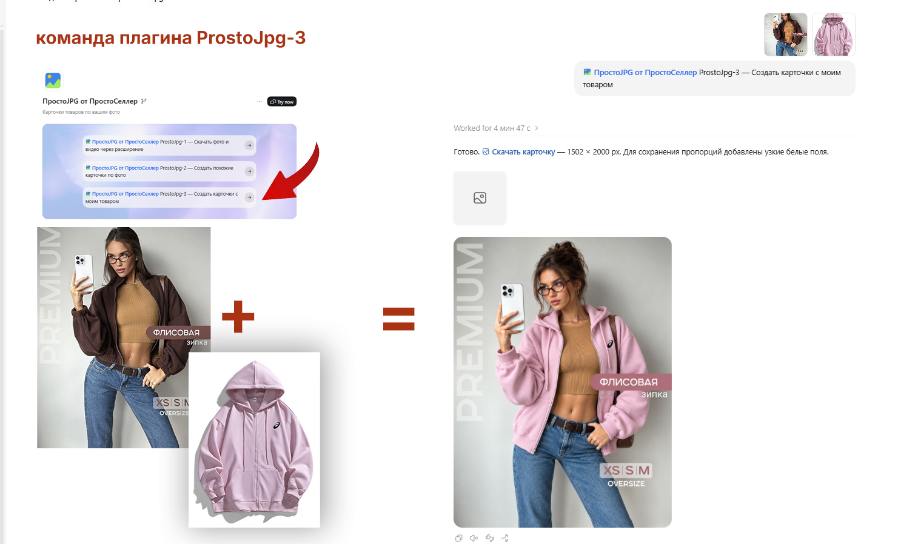

# ПростоJPG от ПростоСеллер

Создавайте карточки товаров для Wildberries и Ozon по загруженным фото. Промпты уже встроены — писать их не нужно.

## 1. Установите расширение для браузера

[](https://chromewebstore.google.com/detail/простоjpg/djjocjgglhbkcfclclilmamlcoggoole)

[**Установить расширение ПростоJPG**](https://chromewebstore.google.com/detail/простоjpg/djjocjgglhbkcfclclilmamlcoggoole) в Chrome или Яндекс Браузер.

## 2. Скачайте нужные фото из карточек товара



Откройте ПростоJPG → **Инструменты Селлера** → **Скачать фото и видео**. Выберите WB или Ozon, введите артикулы и нажмите **Скачать архивы по списку**. Сохраните ZIP с исходными фото на компьютере.

## 3. Установите плагин для Codex или Claude Code

Чтобы Codex или Claude Code установил плагин, напишите ему:

> Установи [https://github.com/8976878-source/ProstoJPG/](https://github.com/8976878-source/ProstoJPG/)

Скопируйте сообщение кнопкой копирования справа в блоке:

```text
Установи https://github.com/8976878-source/ProstoJPG/
```

[**Скачать плагин для Codex**](downloads/prostojpg-plugin-2.0.0.zip) · [**Скачать плагин для Claude Code**](downloads/prostojpg-claude-plugin-2.0.0.zip) · [**Инструкция установки**](INSTALL.md)

Для установки помощнику нужен доступ к вашему компьютеру. Для генерации в Claude Code нужен также установленный Codex с входом через аккаунт ChatGPT и доступной генерацией изображений. Дополнительный плагин генератора и API-ключ не нужны.

## 4. Выберите нужную команду

**ProstoJpg-1 — Создать похожие карточки.** Выберите команду на странице плагина или напишите `$prostojpg-1`, приложите одну или несколько исходных фото карточки товара. Помощник создаст похожие карточки, сохранив товар узнаваемым.



На скриншоте прежний номер ProstoJpg-2; теперь это **ProstoJpg-1**.

**ProstoJpg-2 — Исходная карточка + мой товар + замена лица.** Выберите ProstoJpg-2 или напишите `$prostojpg-2`, приложите исходные карточки, а последним фото — фото своего товара. Помощник заменит товар и изменит лицо и причёску человека, сохранив общий образ.



На скриншоте прежний номер ProstoJpg-3; теперь это **ProstoJpg-2**.

**ProstoJpg-3 — Исходная карточка + мой товар, лицо не меняем.** Выберите ProstoJpg-3 или напишите `$prostojpg-3`, приложите исходные карточки, а последним фото — фото своего товара. Помощник заменит товар, сохраняя лицо, черты лица и узнаваемость человека.

После обновления откройте новый чат, чтобы обновился список навыков. С версии 2.0 прежние команды ProstoJpg-2/3/4 перенумерованы в ProstoJpg-1/2/3; отдельный навык скачивания убран.

Для создания карточек достаточно выбрать режим и загрузить фото. Артикул и собственный промпт не нужны.

В Claude Code команды: `/prostojpg:prostojpg-1`, `/prostojpg:prostojpg-2`, `/prostojpg:prostojpg-3`.

## Результат и генерация

- Соотношение сторон каждого фото сохраняется как у оригинала.
- Короткая сторона — не менее 1200 px; при необходимости изображение масштабируется.
- Готовые фото выдаются отдельными файлами без ZIP, независимо от их количества. Если генератор вернул другую пропорцию, добавляются белые поля без обрезки товара.
- Видео не генерируются.
- Исходники и готовые фото сохраняются на компьютере; для генерации изображения передаются OpenAI.

Используется инструмент генерации изображений Codex через аккаунт ChatGPT. Доступ и лимиты зависят от вашего аккаунта и клиента. Python 3.11+ и Pillow нужны при обработке и сохранении готовых фото; установка плагина их не устанавливает.

Плагин бесплатный; подписка ChatGPT оплачивается отдельно, если она нужна для доступной в вашем аккаунте генерации. Подписка не является фиксированным пакетом изображений.

[Сайт ПростоСеллер](https://prosto-seller.ru/) · [Политика](https://prosto-seller.ru/legal) · [Расширение браузера](https://chromewebstore.google.com/detail/простоjpg/djjocjgglhbkcfclclilmamlcoggoole)

Версия 2.0.0.
